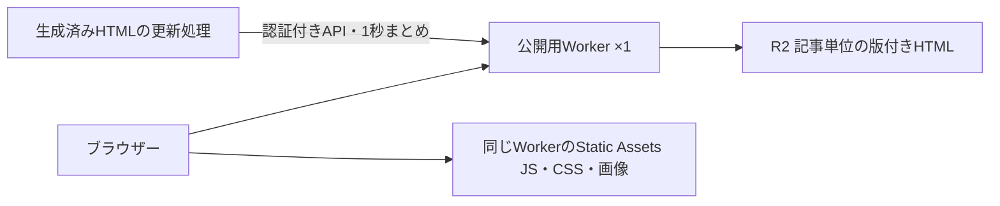

# 差分静的生成とWorker統合の検証

## 目的

公開トップ・記事を開いて本文が見えるまでを短くする。表示と操作を維持し、現在のReader・Gateway・Appという分割やキャッシュ削除方式は前提にしない。

この変更は構成の検証であり、本番の配信方式は変更しない。基準はmain `3e240d4c` のAstroとキャッシュ付きSSR。

## 結論

静的HTMLと編集アプリは1 Workerへ統合できる。Cloudflare Static Assetsが一致するファイルを先に返せば、編集アプリのバンドルが同居しても、公開HTMLの取得でAppのfetchハンドラーを呼ばない。静的配信のためだけにReader・Gatewayを別Workerとして残す理由はない。

ただし、記事保存ごとにStatic Assetsをデプロイする方式の採用は保留する。HTMLの生成・入力取得を省略できても、更新には全パスを含むmanifestと新しいWorkerバージョンが必要になる。検証用のHTML 1ファイルだけの更新でもCLI経由のデプロイに約9.5秒かかった。これはビルド時間や本番でのグローバル反映時間を含む保証値ではない。

次の比較では1 Workerを基本候補とし、コードのデプロイと記事内容の更新を分離する。必要なのは変更した公開物の生成・差し替えであり、Readerの現在のキャッシュ削除経路をそのまま残すことではない。公開物の永続保存とエッジキャッシュを使う方式も比較対象に含める。分割を残すのは、コールド時の実測などで必要と確認できた場合だけにする。

追検証では、記事単位のR2差し替えで内容更新時の再デプロイを0回にした。Durable Objectは使わず、同じ記事への更新を1秒の枠でまとめ、待機中は最新の版を優先する。これは配信更新経路の検証結果であり、本番の保存APIへの接続や、DB保存・HTML生成を含む所要時間の測定は未完了。

## 現状との違い

- 現在のSSRも本文・一覧を最初のHTMLに含む。ReaderのWorkers Cache命中時にはReaderの実行とDB取得を省略する。これは既存の仕組み。
- 差分SSGでは閲覧前にHTMLを生成し、変更のないHTMLを次のビルドへ再利用する。今回新しく検証した範囲。
- Astroの差分ビルドはHTML描画を省略する。入力データ取得、Viteのバンドル処理、公開ファイルの登録・切り替えまで自動で差分になるわけではない。
- キャッシュを削除しても、配信済みの静的ファイルは消えない。非公開化には配信対象から外した新しい公開物の切り替えが必要。

## 再現手順

ロックファイルのAstro 7.4.7とWranglerを使う。Wranglerのtest harnessはBunのfetchでは接続できないため、検証スクリプトはNodeで実行する。接続先は新規のローカルDB、認証値は検証専用、Sentryは無効。

```sh
SENTRY_DSN="" VITE_SENTRY_DSN="" nix develop --command bun run build
nix develop --command node scripts/check-reader-incremental.mjs
```

結果・ビルドログ・生成HTML・ブラウザー画像は、出力された `.data/reader-incremental-<UUID>` に残す。本番の設定・DB・Workerには書き込まない。生成物はコミットしない。

Cloudflare上の更新・削除も検証する場合は、上記で出力されたディレクトリを指定する。認証済みWranglerを使ってUUID付きの隔離Previewを作り、最後に削除する。本番Workerのコード・ルート・DBは変更しない。

```sh
nix develop --command node scripts/check-reader-static-edge.mjs .data/reader-incremental-<UUID>
```

このPreviewはダミー記事の静的HTMLだけを返す。実際のAppのモジュールを同梱するが、動的入口は常に404とし、AppのAPI・DB・service bindingは公開しない。

## ローカル検証の内容

`scripts/check-reader-incremental.mjs` は配信成果物を使う検証境界に置く。`reader/src/pages/[...path].astro` のデータ取得部分だけを検証用ディレクトリで静的入力へ置き換え、既存のLayout・記事・トップ・CSSをそのままビルドする。本番ソースを別実装へ置き換えない。

入力は既存の `/api/reader-data` から取得する。変更キーと各レスポンスの依存キーを照合し、変わっていない入力を再利用する。`getStaticPaths()` の `cacheKey` に入力のハッシュを渡し、Astroの `experimental.incrementalBuild` で描画を省略する。変更キーの利用は検証用の入力取得削減であり、将来の配信方式に現在の無効化処理を必須とする判断ではない。

テスト用記事2件、日本語・英語の記事4 URLと日本語トップの計5 URLで確認する。

| 操作 | 再取得した入力 | 生成したHTML |
| --- | ---: | ---: |
| 初回 | 5 | 5 |
| 変更なし | 0 | 0 |
| 1記事の本文更新 | 3 | 2（対象記事の日本語・英語） |
| その記事の英訳更新 | 3 | 1（英語のみ） |
| コメント追加 | 3 | 3（トップ・対象記事の日本語・英語） |
| 共通テンプレートの変更 | 0 | 5 |
| 対象記事を非公開化 | 1 | 1（トップ）。記事2 URLは削除 |

本文・翻訳が生成HTMLへ反映されたこと、非公開記事のファイルが削除されたことも検証する。依存キーが変わっても実際の入力が同じ場合は描画しない。変更なしでも公開URL一覧・変更版のメタデータは読むため、「DB取得が一切ないビルド」とは呼ばない。

本文のセグメントと翻訳の描画まで確認した実行では、初回5,861ms、変更なし5,138ms、本文更新3,965ms、英訳更新3,590msだった。描画を省略してもビルドの固定費が残る。5 URLだけのローカル計測であり、実運用規模の性能結果ではない。全記事の本文取得を省略することと、全URLの列挙をなくすことは別。

現在の3 Worker構成と、同じApp・静的ファイルをまとめた1 Worker構成、静的入口＋Appの2 Worker構成も同じローカルWorkersランタイムで比較する。

| 構成 | 公開HTMLでのfetchハンドラー呼び出し | 認証APIでの呼び出し |
| --- | ---: | ---: |
| 1 Worker | 0 | App 1回 |
| 2 Worker | 0 | 入口とAppの計2回 |

公開HTMLでは両構成ともDB通信0回。HTTPの入口を使い、特定Workerへの直接呼び出しと異なるStatic Assetsの優先ルーティングも通す。Chromium・WebKit、1280px・390px幅、トップ・記事の初回表示を既存SSRと比較する。外部JSを止めてHTMLの表示を比較する検証であり、ログイン・編集・いいねなど全操作の移行完了を意味しない。

画面比較はPlaywright標準の `toHaveScreenshot` を使い、SSRからの基準画像作成と比較を別実行にする。比較時は基準画像を更新せず、`maxDiffPixels: 0` とする。初回の描画が安定する前のPNGを単発で比較する処理は残さない。

## Cloudflare上の確認

2026-11-14、ダミー記事を使った隔離Previewで確認した。通常の動的入口は404になるため、HTMLの200はAppのfetchを通らない静的配信によるもの。

| 操作 | CLI実行開始からデプロイコマンド完了まで | 確認結果 |
| --- | ---: | --- |
| 初回登録 | 11,888ms | HTML 200、旧本文を含む |
| HTML 1ファイル更新 | 9,459ms | アップロード1ファイル、200、新本文を含む |
| HTML削除 | 9,168ms | 新規アップロード0ファイル、404 |

可変Preview URLが旧HTMLを返した後続実行もあったため、スクリプトでは新しいデプロイ固有URLの内容と、可変URLが同じ内容へ収束する時点を分けて検証する。切り替え待ちの各応答も結果へ残す。修正後の実行は初回CLI 8,476ms／内容一致確認9,307ms、更新9,959ms／10,558ms、削除9,238ms／10,426msだった。内容一致確認の時間には検証用HTTP通信も含む。

さらに再実行した削除ではCLI完了9,479msの後も可変URLが200を返し続け、21,608msで404を確認した。CLI完了を非公開化の完了条件にすることはできない。

いずれも少数のPreview計測。本番の保存応答時間、同時更新時の待ち時間、全地域での切り替え時間は未計測。Previewは検証後に削除済み。

## 再デプロイを待たない配信更新

```sh
nix develop --command node scripts/check-reader-publication.mjs .data/reader-incremental-<UUID>
```

`scripts/reader-publication-worker.ts` は配信更新の検証専用。1 Workerを初回だけ配信し、以降は記事単位の生成済みHTMLをR2 bindingで差し替える。JS/CSS・画像は同じWorkerのStatic Assetsで配信する。生成HTMLを配る検証境界のため`scripts`に置き、実際の保存API・DB・編集アプリは公開しない。HTMLの公開用原稿を新設するものではない。



同じ記事の待機中の更新はWorker内でまとめ、1秒後に最新の版だけを書く。後から到着した古い版を優先しない。待機時間を更新ごとに延長せず、書き込み中に来た更新は次の枠へ送る。メモリ内の待機は永続キューではなく、保存完了まで成功応答を返さない。別Workerインスタンス間はR2の条件付き書き込みで競合を検知し、直近の書き込みから1秒未満なら待つ。競合・一時失敗は`Retry-After: 1`付きで返す。保存APIとの接続時には、未完了の更新を永続化し、再試行時の最新DB版から再生成する。調停用のDurable Object・Cron・Queueは追加しない。

記事の言語別HTMLと版を1オブジェクトに入れ、R2の条件付きputで差し替える。非公開化は版付きの削除記録を残し、過去の生成結果では再公開できないようにする。版をオブジェクト本文にも入れるため、削除記録の更新でもETagが変わる。同じ版・同じ内容の再送は成功し、保存済みより古い版や、同じ版の違う内容は409とする。待機中に新しい版へまとまった要求は、その新しい版の永続化後に成功を返す。並行保存の競合後も最新の版の再送だけで収束することを、ローカルWorkersランタイムとCloudflare上で確認する。

既存R2 bucketの中にUUID付きの専用prefixを作り、ダミー記事だけを入れる。更新APIは一時的な秘密値で認証する。検証後は今回のキー・Preview・秘密値ファイルを削除する。R2の本番オブジェクトや、本番Worker・ルートは変更しない。

2026-11-14、1秒の待機を含む計測（5回ずつ、単位ms）:

| 操作 | 保存応答の中央値 | 保存応答の範囲 | 送信開始から最初のGET確認までの中央値 |
| --- | ---: | ---: | ---: |
| 本文の差し替え | 1,253 | 1,236–1,271 | 1,439 |
| 非公開化 | 1,235 | 1,212–1,364 | 1,453 |

初回のコード配信と準備は5,136ms。各内容更新の再デプロイは0回。日本語・英語への後続GETはポーリングせず、最初の応答を検査する。両言語の確認完了は本文更新が中央値1,529ms、非公開化が1,520msだった。変更していない別の記事のETagも変わらないことを確認した。旧版による非公開化の取り消しを5回拒否し、並行保存後の再送も確認した。ローカルWorkersでは20件の同時更新が最新の版へまとまり、待機中の非公開化も優先されることを検証する。

数字は前節と同じく、**生成済みHTMLの配信更新だけ**を測ったもの。DB保存・Astro描画・全地域での確認時間は含めない。HTML共有キャッシュは使わず、R2の読み取りで確認しているため、現行のキャッシュ命中時の閲覧より速いとは結論しない。保存APIと生成処理の接続、全URL・全操作の維持、共有キャッシュの整合性と閲覧速度を確認するまで本番へ切り替えない。

画面比較は`scripts/compare-reader-html.mjs`を、既存の差分ビルド検証と今回のR2配信検証から共用する。複数利用箇所は`check-reader-incremental.mjs`と`check-reader-publication.mjs`で、基準画像の更新と比較時の上書き禁止が別々の実装でずれると、表示の違いを見逃すため共通化する。Chromium・WebKit、PC・モバイル幅のトップ・記事を、同じ静的HTMLのStatic Assets配信と比較する。

## 本番採用前に解決すること

1. **内容更新とコード更新を分離する。** 保存・翻訳・コメントのたびに全サイトのmanifestを組み直してグローバルなデプロイを直列化する構成を基本にしない。公開物の差分更新と、コード変更によるテンプレート再生成を分けて計測する。
2. **公開物の更新完了を定義する。** 本文保存・非公開化・削除の成功時には新しい公開状態を返す。生成・差し替え失敗を永続化し、DBに差分のない再試行でも完了させる。同時保存の古い生成結果が新しい内容や非公開化を上書きしないことを検証する。
3. **全URLを維持する。** `?view=source` を現行SSRは反映するが、通常の静的ファイルは `both` のまま返す。コメント21件で `?page=2` のHTMLも異なることを検証する。URLを維持した内部ルーティングが必要。クエリを使うページだけ単純に動的へ戻す案も、静的ファイル優先ではそのまま実現できない。
4. **対象範囲を拡張する。** 現行21言語、著者・新着・タグ一覧、一覧ページ数の増減、表示形式、返信、投票、人気順更新、メタデータ、初回未生成URLも検証する。保存完了を全言語・全形式・全一覧ページの同期生成待ちにしない。
5. **個別応答を分ける。** 所有者の下書きプレビュー、認証セッション、検索を共有HTMLへ入れない。言語Cookie、メンテナンス停止、旧バージョンURLのアクセス制御も新しい配信経路へ設計し直す。
6. **ビルドキャッシュの契約を整える。** Astroキャッシュと入力キャッシュをCI間で引き継ぐ。Backend・依存コード・locale設定などの変更で古い入力を再利用しない。今回の入力キャッシュは同一プロセス内だけで、再起動をまたぐ実装ではない。
7. **実データ規模で比較する。** 閲覧のcold/hit、保存の単発・並行、翻訳の集中更新、失敗後の再試行を同じ条件で比較する。生成量・更新処理量が全記事数に比例しないことを確かめる。旧ハッシュ付きJS/CSSの30日保持も維持する。

## 参照

- [Astroの差分静的ビルド](https://docs.astro.build/en/reference/experimental-flags/incremental-build/): cacheKeyとモジュール依存による再生成。現在はexperimental。
- [Static AssetsとWorker scriptの優先順](https://developers.cloudflare.com/workers/static-assets/routing/worker-script/): ファイルが一致すればWorker実行前に返す。
- [Static Assetsの直接アップロード](https://developers.cloudflare.com/workers/static-assets/direct-upload/): 変更ファイルだけを転送できるが、manifestは必要な全パスを含め、Workerバージョンへ関連付ける。
- [Workers Cache](https://developers.cloudflare.com/workers/cache/): キャッシュ照合はWorkerの前で行われる。既存Readerも使用しているため、これ自体を新しい高速化とは扱わない。
- [R2の整合性](https://developers.cloudflare.com/r2/reference/consistency/)、[条件付き書き込み](https://developers.cloudflare.com/r2/api/workers/workers-api-reference/#conditional-operations): 更新完了後の読み取りとETag条件による差し替え。
- [R2の制限](https://developers.cloudflare.com/r2/platform/limits/): 同じキーへの書き込み間隔を守り、競合時は最新の版を再試行する。
- [Playwrightの画面比較](https://playwright.dev/docs/test-snapshots): 安定したスクリーンショットを待って比較する。
